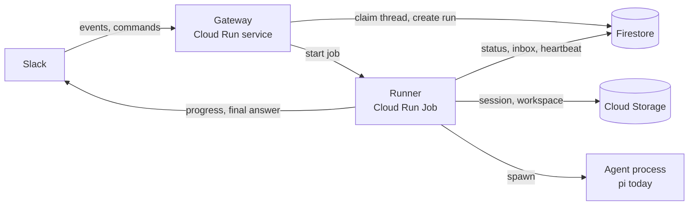

# Architecture (Draft)

> **Status: proposal for discussion. Nothing in this document is approved, implemented, or locked in.**
>
> This is deliberately high level. Code layout, database schemas, deployment steps, and library choices are deferred until the shape is agreed. Proposed answers to the open questions below are in [`PROPOSALS.md`](PROPOSALS.md); they are recommendations, not decisions.

## The idea

A Slack-native coding agent that feels like a long-running teammate but costs like a serverless app. Each Slack thread gets a real agent session. The agent runs only when there is work; between runs, its conversation and workspace live in durable storage.

The first version was a Python Slack bot making plain LLM completions. It worked, but a full agent is materially better for real work. The expensive alternative is a long-running VM with an agent process always available. The proposed middle ground is a warm Slack gateway plus a short-lived agent container per turn.

## Constraints

| Constraint | Consequence |
|---|---|
| Slack wants an acknowledgement within about 3 seconds | The Slack-facing layer must be fast and idempotent. |
| A useful agent run can take minutes to about an hour | The work cannot live inside the Slack request. |
| Cloud Run requests have a 60-minute ceiling and CPU is throttled after the response | "Ack, then keep working in the background" is fragile. |
| Cloud Run disk is ephemeral | Conversation and workspace state need external storage. |
| Traffic is low and bursty | Scale-to-zero matters; per-run cost matters more than raw throughput. |
| Agents execute arbitrary code | Runs need isolation and narrow credentials. |

## Proposed shape

Two deployables, one repository:

1. **Gateway** — a small, warm Cloud Run service running Slack Bolt. It verifies Slack, acknowledges quickly, and decides whether a thread is free or busy.
2. **Runner** — a Cloud Run Job execution per turn. It restores the thread, runs the agent, reports progress, persists state, and exits.

Durable state is split by shape:

- **Firestore** — coordination: thread status, one active run per thread, a follow-up inbox, run records, and event deduplication.
- **Google Cloud Storage** — bulk state: the agent session transcript, workspace snapshots, and artifacts.

## Why this shape

- **Slack ack and agent work are different problems.** Split them instead of holding a request open or hoping background work survives instance lifecycle.
- **A Job fits a one-shot agent better than a service.** No request deadline, no CPU-throttling tricks, natural per-run isolation, and billing only while it runs.
- **The state is the product.** The agent session is the conversation; the workspace is the code. Both survive cold starts because they live outside the container.
- **One active run per thread keeps behavior predictable.** Follow-ups wait in an inbox, and the active run can steer or pick them up.
- **The agent should be replaceable.** A thin interface keeps Slack and persistence independent of pi, Claude Code, or Codex.

## One turn, end to end

1. Slack sends an event, command, or button action to the gateway.
2. The gateway verifies the request, ignores bots and edits, and deduplicates the event.
3. The gateway tries to claim the thread in a single transaction.
   - If the thread is idle: mark it starting, create a run record, and start a runner job.
   - If the thread is busy: append the message to the thread's inbox and acknowledge.
4. The job claims the run, starts a heartbeat, and restores the session and workspace from storage.
5. The job starts the agent and posts a single progress message in the thread.
6. While the agent works, the job updates progress at a throttled rate, polls the inbox for follow-ups, and checks for cancellation.
7. When the agent settles, the job persists the session and workspace, then posts the final answer.
8. The job marks the thread idle only if the inbox is empty; otherwise it handles the next message in the same run.

If a job dies, the missing heartbeat lets a reconciler mark the thread stale and either retry or report failure.

## State model

The important invariants, independent of schema:

- Only one run may own a thread at a time.
- Claiming a thread and enqueueing a follow-up must be atomic.
- Finishing a turn must check the inbox in the same transaction, or a message can be lost during finalization.
- Heartbeats distinguish a live run from a dead one.
- Session and workspace are checkpointed before the job exits, including on abort and timeout.
- Slack event IDs are deduplicated so retries are harmless.

Firestore is the coordinator, not the transcript. The transcript belongs in the agent's session file; the workspace belongs in object storage.

## Agent boundary

The proposed interface is intentionally small:

- start a session
- send a prompt
- steer a running session
- abort
- stop
- subscribe to a normalized event stream
- return the last answer
- produce a session snapshot

Pi is the first backend because its RPC mode is a stable JSONL protocol and its sessions are portable files. Claude Code and Codex could be adapted later, but the interface should expose **capabilities** (steering, session resume, MCP, images) rather than pretend all agents behave the same.

MCP is the likely route for GitHub and other integrations. Slack-specific actions (post an interim message, upload a file, react) are better handled by a small tool extension scoped to the current thread than by giving the agent broad workspace access.

## Alternatives considered

| Alternative | Why it is not the current proposal |
|---|---|
| Long-running VM per bot or per user | Paying for idle, operational overhead, no per-run isolation. |
| Single Cloud Run service that acks then works in the background | CPU throttling and scale-in can kill the run. |
| Cloud Run service worker holding the request open | 60-minute cap, concurrency routing for follow-ups, and a fake long-lived request. |
| Cloud Tasks or Pub/Sub push into a service | Shorter delivery deadlines and duplicate-delivery handling still need continuation logic. |
| Cloud Run Job (proposed) | Chosen as the best fit for one-shot, long, isolated work. |
| GCS FUSE or Filestore for the workspace | Worth revisiting for large repositories, but slower for many small files and more infrastructure. |

## Open questions

These need a decision before implementation:

1. **Runner shape.** Cloud Run Job per turn is the recommendation. Is there a reason to prefer a service worker with a queue instead?
2. **Workspace strategy.** Snapshot the whole workspace, shallow-clone the repo each run, or mount shared storage? Snapshot-plus-clone is the simplest starting point.
3. **Follow-up latency.** Polling a Firestore inbox is simple but adds a few seconds. Is lower-latency steering worth more complexity?
4. **GitHub authentication.** Personal access token is easy; a GitHub App with short-lived installation tokens is the better multi-tenant answer.
5. **Multi-workspace installs.** OAuth installation storage, token rotation, and per-team policy are not designed yet.
6. **Progress UX.** Status updates plus a final answer are cheap and quiet. Is token-level streaming actually wanted?
7. **Sandboxing.** Is the Cloud Run container enough, or do agent runs need stricter egress and filesystem controls?
8. **Retention and cost.** How long do sessions and workspaces live, and what is the per-run model budget?

## Explicitly not decided yet

- Repository and package layout
- Firestore collection names and fields
- Exact Cloud Run Job and service settings
- Model/provider defaults
- Whether the gateway and runner share an image
- Deployment tooling (Terraform, Cloud Build, manual `gcloud`)
