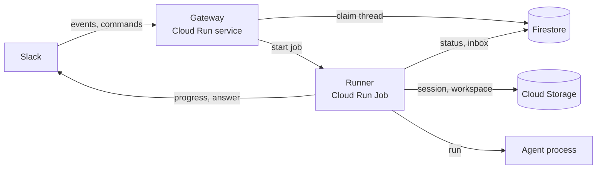

# serverless-slack-agent

A design exploration for a serverless, stateful Slack coding agent.

The goal: users get a full coding agent in a Slack thread — not a single completion — while the system stays cheap at low traffic and survives cold starts. The proposed middle ground is a warm Slack gateway plus one short-lived Cloud Run Job per turn, with the conversation and workspace persisted outside the container.

> **Status: design only.** Nothing here is approved or implemented yet. The architecture is in [`ARCHITECTURE.md`](ARCHITECTURE.md); proposed answers to its open questions are in [`PROPOSALS.md`](PROPOSALS.md).

## The problem

Slack wants an acknowledgement in about three seconds. A useful coding agent needs minutes. Cloud Run containers are ephemeral, and a Cloud Run service request is capped at 60 minutes. A long-running VM solves the latency problem but pays for idle time and concentrates risk in one always-on process.

There is a gap between "plain LLM completion in a Slack bot" and "always-on agent VM." This project is exploring that gap.

## The proposed shape

- A **Gateway** Cloud Run service handles Slack: verify, deduplicate, acknowledge, and decide whether a thread is free or busy.
- A **Runner** Cloud Run Job handles one agent turn: restore state, run the agent, report progress, persist, and exit.
- **Firestore** coordinates threads, runs, and follow-ups.
- **Cloud Storage** holds the agent session, workspace snapshots, and artifacts.
- A thin **agent interface** keeps the Slack layer independent of pi, Claude Code, or Codex.

## What this repository is

- A place to settle the architecture before committing to an implementation.
- A short, opinionated proposal with alternatives and open questions.

## What it is not yet

- An implementation.
- A deployment setup.
- An approved design.

## Next step

Read [`ARCHITECTURE.md`](ARCHITECTURE.md) and [`PROPOSALS.md`](PROPOSALS.md), challenge the assumptions, and decide the open questions before scaffolding code.
